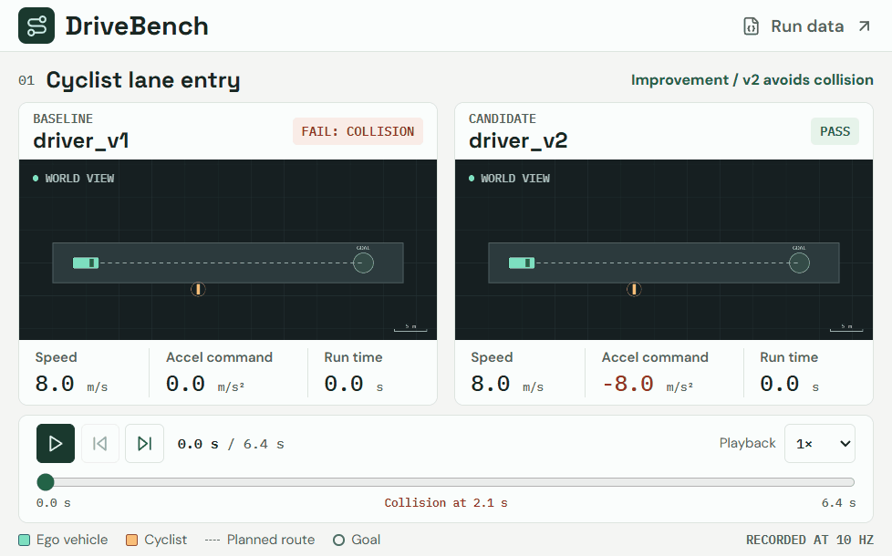

# DriveBench

A deterministic, closed-loop 2D driving simulation core written in C++, with JSON scenarios, a rule-based autonomous driver, and an evaluator that scores every run. The world moves in response to ego commands, and yielding traffic reacts to ego's new state on subsequent ticks. This is a portfolio-scale simulator, not a road-safety certification tool.



**Seed 42:** V2 avoids the cyclist collision but regresses on the pedestrian crossing. [See the metrics and paired trajectories](docs/run_report.md).

## Build and test

Requires CMake 3.20+, a C++20 compiler, and Python 3.9-3.13 with development headers for the optional binding. CMake finds or fetches nlohmann/json and pybind11. The C++ library target is `drivebench` (`libdrivebench` on Unix).

```sh
cmake -S . -B build -DCMAKE_BUILD_TYPE=Release -DDRIVEBENCH_PYTHON=ON
cmake --build build --config Release --parallel 2
ctest --test-dir build -C Release --output-on-failure
```

Omit `-DDRIVEBENCH_PYTHON=ON` for a C++-only build. On a single-config build, use `export PYTHONPATH="$PWD/build/bindings"` to import the module. In PowerShell with a Visual Studio build, use `$env:PYTHONPATH = "$PWD/build/bindings/Release"`.

```python
from pydrivebench import run_scenario

result = run_scenario("scenarios/pedestrian_crossing.json", "driver_v1", 42)
print(result.verdict.passed, result.metrics["min_distance"])
```

## Evaluation workflow

```sh
python tools/run_suite.py scenarios --version driver_v1 --output build/suite.json
python tools/run_suite.py scenarios/pedestrian_crossing.json --seed 0 --seed-count 100 --output build/seed-sweep.json
python tools/vary_scenario.py scenarios/pedestrian_crossing.json build/variants --count 100 --seed 42
python tools/run_suite.py build/variants --output build/variant-suite.json
python tools/compare_versions.py scenarios build/comparison --seed 42
```

Use a fresh output directory for each variant set or comparison. Add `--trajectories` to the suite command to include every replay. The comparison writes both trajectories for each changed failure set; add `--fail-on-regression` to exit 1 if any paired run gains a failure category. Aggregate improvements never hide individual regressions from that gate.

## Replay viewer

Run `python -m http.server 8765 --bind 127.0.0.1` from the repository root, then open [the local viewer](http://127.0.0.1:8765/viewer/). No native build is needed: the viewer reads the checked-in seed-42 comparison, trajectories, and scenario geometry. It shows the cyclist improvement and pedestrian regression using one shared playback timeline.

## Evidence and developer guides

- [Reference evaluation](docs/run_report.md): v2 repairs one cyclist case but regresses on three pedestrian cases at seed 42.
- [Architecture](docs/architecture.md) and [determinism contract](docs/determinism.md).
- [Scenario library and authoring guide](docs/scenario_guide.md).
- [Metric definitions, fixture math, and extension guide](docs/metric_definitions.md).

GitHub Actions runs CTest on Linux and Windows, with a separate Linux ASan/UBSan job. To run locally with GCC or Clang on Linux:

```sh
cmake -S . -B build-sanitized -DCMAKE_BUILD_TYPE=Debug -DDRIVEBENCH_SANITIZERS=ON
cmake --build build-sanitized --parallel 2
ASAN_OPTIONS=halt_on_error=1:detect_leaks=1 UBSAN_OPTIONS=halt_on_error=1 ctest --test-dir build-sanitized --output-on-failure
```

For a container build, run `docker build -f core/Dockerfile -t drivebench .` followed by `docker run --rm drivebench`.