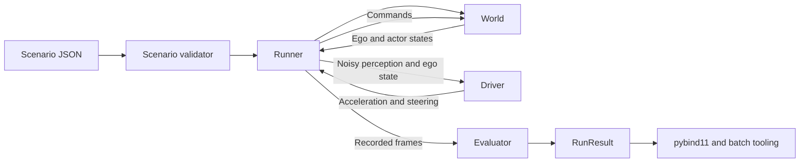

# Architecture

The simulation runs entirely in C++. Python orchestrates batches and reads results; it is not called back on the tick loop.

| Module | Owns | Dependency boundary |
| --- | --- | --- |
| World | Tick, boxes, motion, and reactive actors | Leaf; no driver, JSON, or scoring logic. |
| Scenario | Typed setup and JSON validation | Shared config/geometry types and JSON parser; no running world or planner. |
| Driver | Route following, stop control, and gap checks | Gets the route, rules, and `Observation`, never a `World` instance or evaluator. |
| Runner/recorder | Noise, orchestration, terminal conditions, frame capture and replay bytes | Couples modules and records ground truth separately from perceived boxes. |
| Evaluator | Metrics, configured verdicts, suite aggregation | Reads frames, criteria, road rules, and pure box geometry, not mutable world state. |
| Python | Variants, runs, reports, and regression gate | Calls native `run_scenario` and consumes the public result. |

For each tick, the runner snapshots the world, checks goal, road and overlap, perturbs actor positions, and asks the driver for a command if nonterminal. The world integrates ego and updates traffic from the previous ego state. Traffic flagged `yields_to_ego` can slow or stop when its projected intent conflicts with ego; the resulting state enters the next observation. The `feedback` test changes only ego commands and checks that the traffic trajectory changes.

## Design choices

- **Fixed versus variable timestep.** A constant 0.1 s gives a predictable update order and unambiguous braking and jerk samples. It can miss collisions between samples. Collision itself is sampled, not continuous.
- **OBB versus point collision.** Separating axes represent heading and actual footprint, including corner contact, at modest cost. TTC sweeps the same axes assuming constant velocities and fixed orientations. The lane constraint samples the ego center, corners, and edge midpoints against the union of lane polygons. It is not exact area containment for arbitrarily shaped roads.
- **Rule-based versus learned.** Pure-pursuit-style route tracking, bounded acceleration, stop-sign holds, and buffered TTC thresholds are easy to inspect and regression-test. Constant-velocity prediction, longitudinal braking instead of evasive steering, position-only perception noise, and the lack of occlusion or tire dynamics limit the domain.
- **Physical simplifications.** Ego and other vehicles use a midpoint kinematic bicycle update with 2.7 m wheelbase. Pedestrians and cyclists follow waypoints at piecewise constant velocity. Friction limits positive and negative longitudinal acceleration; it does not model lateral slip. Traffic is not an independent full autonomy stack.

`driver_v1` uses TTC windows of 2.0 s for cars, 2.2 s for pedestrians, and 0.45 s for cyclists. `driver_v2` keeps the car window, increases the cyclist window to 2.3 s, and deliberately shortens the pedestrian window to 0.35 s to demonstrate regression detection. `never_brake` is a negative control that cannot command negative acceleration.